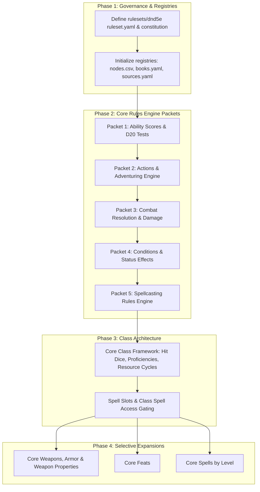

# 5th Edition Rules Graph Integration Proposal

**Author:** Antigravity  
**Date:** 2026-10-26  
**Status:** Proposal / Review  
**Target Repository:** `dnd` Mechanical Relationship Graph System  

---

## 1. Executive Summary

The repository has successfully ingested and canonicalized full mechanical graphs for:
- **AD&D 1st Edition** (`adnd1e`)
- **Basic D&D Rules Cyclopedia** (`basicdnd/rc`) — 754 edges, 273 nodes, 21 integrated packets, 0 invariant violations.

With the addition of the **`5etools`** data tree, we now have access to a complete digital extraction of 5th Edition content. However, ingesting the full 152 MB archive indiscriminately would introduce tens of thousands of entity instances (individual monster statblocks, adventure encounter keys, flavor tables, third-party setting lore) that would overwhelm the mechanical graph without adding rules engine value.

This proposal defines a **surgical, high-signal ingestion path** designed to extract the core mechanical rules engine of 5th Edition into an independent ruleset graph using the existing repository workflow (**Analyst $\to$ Builder $\to$ Reviewer $\to$ Integrator**).

---

## 2. 5etools Data Inventory & Scope Analysis

The `5etools/` folder contains **2,146 files** totaling **151.7 MB**. A directory-by-directory audit categorizes this data into four distinct tiers:

| Tier | Category / Paths | Size | Description | Ingestion Action |
| :--- | :--- | :---: | :--- | :--- |
| **Tier 1: Engine Core** | `data/book/book-phb.json`<br>`data/book/book-xphb.json`<br>`data/actions.json`<br>`data/conditionsdiseases.json`<br>`data/variantrules.json` | **~5 MB** | Core rules chapters: ability scores, D20 tests, actions, combat resolution, conditions, adventuring, resting, spellcasting rules, and the 2024 Rules Glossary. | **Primary Ingestion Target** (Phases 1 & 2) |
| **Tier 2: Character Framework** | `data/class/class-*.json`<br>`data/spells/spells-phb.json`<br>`data/spells/spells-xphb.json` | **~5 MB** | 12 core classes (hit dice, proficiencies, resource progressions like Rage/Ki/Spell slots) and iconic core spells. | **Secondary Ingestion Target** (Phase 3) |
| **Tier 3: Catalogs & Equipment** | `data/items.json`<br>`data/items-base.json`<br>`data/feats.json`<br>`data/races.json`<br>`data/backgrounds.json` | **~15 MB** | Weapons, armor, standard equipment, racial traits, background proficiencies, and feats. | **Selective Ingestion** (Phase 4) |
| **Tier 4: Non-Rules Content** | `data/adventure/` (~49 MB)<br>`data/bestiary/` (~17 MB)<br>`js/`, `css/`, `icon/`, `*.html` (~50 MB)<br>`data/recipes.json`, `data/decks.json` | **~127 MB** | Static site code, adventure modules, monster statblock collections, deck cards, cookbook lore. | **Excluded Entirely** |

---

## 3. Core Architectural Decision: 2014 vs. 2024

5etools tags every single entity with an explicit source publication code:
- **2014 Core Baseline**: `PHB` (*Player's Handbook 2014*), `DMG` (*Dungeon Master's Guide 2014*), `MM` (*Monster Manual 2014*).
- **2024 Revised Core**: `XPHB` (*Player's Handbook 2024*), `XDMG` (*Dungeon Master's Guide 2024*), `XMM` (*Monster Manual 2025*).

### Structural Comparison

| Dimension | 2014 Core (`PHB`) | 2024 Revised Core (`XPHB`) |
| :--- | :--- | :--- |
| **Rules Architecture** | Distributed across Chapters 7–10 (Ability Scores, Adventuring, Combat, Spellcasting). | Centralized **Rules Glossary** (159 formally defined rules, conditions, and concepts on pages 360–378) plus Chapter 1 ("Playing the Game"). |
| **Standardized Mechanics** | Ad-hoc terminology in places (e.g. natural 20 rules vary by table; contest mechanics vs checks). | Formalized **D20 Test** (unifying Ability Checks, Attack Rolls, and Saving Throws); **Heroic Inspiration**; standardized condition tags. |
| **Condition Overhauls** | Exhaustion had 6 discrete escalating levels; Grappled/Incapacitated had nuanced interactions. | Exhaustion simplified to -2 to D20 tests per level; conditions are cleanly modularized with precise triggers and saving throw ends. |

### Strategic Paths

1. **Option A (Recommended): 2014 Baseline First (`dnd5e/phb`)**
   - Follows the exact repository precedent established with `adnd1e` and `basicdnd`.
   - Models the foundational 2014 5e engine that 10 years of material was built on.
   - Allows 2024 to be introduced later as a structured evolution, revision, or dedicated supersession layer (`dnd5e/xphb` or `dnd5e24`).
2. **Option B: 2024 Revised Directly (`dnd5e24/xphb` or `dnd5e/xphb`)**
   - Capitalizes on the 2024 Rules Glossary, which is already structured like an ontology definition with 159 strict terms.
   - Ideal if the user's primary focus is modern 5.5e / 2024 play.
3. **Option C: Dual Independent Rulesets (`dnd5e` and `dnd5e24`)**
   - Keeps 2014 and 2024 as completely separate graph silos with no shared baseline, matching how `adnd1e` and `basicdnd` are decoupled.

---

## 4. Phased Ingestion Roadmap

We propose structuring the 5e ingestion into four clear phases, prioritizing the rules engine before entity catalogs.



### Phase 1: Governance & Ruleset Bootstrap
- Establish `rulesets/dnd5e/`:
  - `ruleset.yaml` (`ruleset_id: dnd5e`, `name: D&D 5th Edition`).
  - `governance/constitution.md` (defining edge types, polarity ownership, citation standards).
  - `registries/books.yaml` (registering `phb` with source `phb-5etools-intake`).
  - `registries/sources.yaml`.
  - `registries/nodes.csv` (initialized with empty baseline).
  - `schemas/dnd5e/` (graph and registry schemas).

### Phase 2: The Core Rules Engine (5 Targeted Packets)
Each packet is extracted from `5etools/data/book/book-phb.json` (Chapters 7–10 and Appendix A):

1. **Packet 1 (`PKT-5E-PHB-CH07-abilities-and-tests`)**:
   - Ability scores, ability modifiers, Proficiency Bonus.
   - Ability Checks, Advantage / Disadvantage mechanics.
   - Saving Throws (Strength, Dexterity, Constitution, Intelligence, Wisdom, Charisma).
   - Passive checks (Passive Perception).
2. **Packet 2 (`PKT-5E-PHB-CH08-adventuring-and-actions`)**:
   - Time, movement speeds (Walking, Climbing, Swimming, Flying, Jumping).
   - Environmental rules (Suffocation, Vision, Light, Darkness, Cover).
   - Rest & Recovery: Short Rest vs. Long Rest mechanics, Hit Dice spending.
   - Action economy: Action, Bonus Action, Reaction, Free object interaction.
   - Standard actions: Attack, Cast a Spell, Dash, Disengage, Dodge, Help, Hide, Ready, Search, Use an Object.
3. **Packet 3 (`PKT-5E-PHB-CH09-combat-resolution`)**:
   - Order of Combat, Initiative (`cbt_initiative`), surprise.
   - Attack rolls (`cbt_attack_roll`), Armor Class (`cbt_armor_class`), Critical Hits.
   - Damage rolls (`cbt_damage`), Damage types (Bludgeoning, Piercing, Slashing, Fire, Cold, Lightning, Thunder, Acid, Poison, Necrotic, Radiant, Force, Psychic).
   - Damage Resistance, Vulnerability, and Immunity.
   - Dropping to 0 Hit Points: Instant Death, Knockout, Death Saving Throws, Stabilization.
4. **Packet 4 (`PKT-5E-PHB-APPA-conditions`)**:
   - The 15 core conditions: Blinded, Charmed, Deafened, Frightened, Grappled, Incapacitated, Invisible, Paralyzed, Petrified, Poisoned, Prone, Restrained, Stunned, Unconscious, Exhaustion.
   - Exact mechanical relationships from condition nodes to `cbt_attack_roll`, `cbt_armor_class`, `ex_movement`, saving throws, and action denial.
5. **Packet 5 (`PKT-5E-PHB-CH10-spellcasting-rules`)**:
   - Spell slots, spell levels (cantrips vs. leveled spells).
   - Casting time, components (Verbal, Somatic, Material, Spellcasting Focus).
   - Duration, Concentration mechanics and concentration disruption saves.
   - Range, Areas of Effect (Cone, Cube, Cylinder, Line, Sphere).
   - Combining magical effects.

### Phase 3: Character Class Engine
Ingest the 12 base classes from `5etools/data/class/` and `book-phb.json` Chapter 3:
- Base class chassis: Hit Dice (`d6`, `d8`, `d10`, `d12`), armor proficiencies, weapon proficiencies, saving throw proficiencies.
- Core resource tracks: Barbarian *Rage*, Bard *Bardic Inspiration*, Cleric *Channel Divinity*, Druid *Wild Shape*, Fighter *Action Surge* & *Second Wind*, Monk *Ki*, Paladin *Divine Smite* & *Lay on Hands*, Ranger *Favored Enemy*, Rogue *Sneak Attack*, Sorcerer *Sorcery Points*, Warlock *Pact Magic*, Wizard *Arcane Recovery* & *Spellbook*.

### Phase 4: Selective Expansions
- **Weapons & Armor**: Base equipment table (`items-base.json`) establishing weapon properties (Finesse, Heavy, Light, Loading, Reach, Thrown, Two-Handed, Versatile) and armor categories (Light, Medium, Heavy, Shields).
- **Core Feats**: Feats from Chapter 6.
- **Core Spells**: Incremental packets grouped by spell level, following the proven model from `basicdnd/rc`.

---

## 5. 5e Ontology & Node Prefixes

To maintain strict invariant compliance with `contracts/GRAPH_INVARIANTS.md`, 5e nodes will adopt standardized snake_case prefixes:

| Category | Node Prefix | Examples |
| :--- | :--- | :--- |
| **Abilities & Attributes** | `abil_` | `abil_strength`, `abil_dexterity`, `abil_constitution`, `abil_intelligence`, `abil_wisdom`, `abil_charisma` |
| **Proficiencies & Checks** | `prof_` | `prof_bonus`, `prof_athletics`, `prof_stealth`, `prof_perception` |
| **Combat Mechanics** | `cbt_` | `cbt_attack_roll`, `cbt_armor_class`, `cbt_damage`, `cbt_initiative`, `cbt_death_save`, `cbt_hit_points` |
| **Saving Throws** | `save_` | `save_strength`, `save_dexterity`, `save_constitution`, `save_intelligence`, `save_wisdom`, `save_charisma` |
| **Standard Actions** | `act_` | `act_dash`, `act_disengage`, `act_dodge`, `act_help`, `act_hide`, `act_ready`, `act_search`, `act_use_object` |
| **Conditions** | `cond_` | `cond_blinded`, `cond_charmed`, `cond_frightened`, `cond_grappled`, `cond_incapacitated`, `cond_invisible`, `cond_paralyzed`, `cond_petrified`, `cond_poisoned`, `cond_prone`, `cond_restrained`, `cond_stunned`, `cond_unconscious`, `cond_exhaustion` |
| **General Rules** | `rule_` | `rule_advantage`, `rule_disadvantage`, `rule_concentration`, `rule_short_rest`, `rule_long_rest`, `rule_cover` |
| **Character Classes** | `class_` | `class_fighter`, `class_wizard`, `class_rogue`, `class_cleric`, etc. |
| **Spells** | `spell_` | `spell_fireball`, `spell_shield`, `spell_magic_missile`, `spell_cure_wounds` |
| **Feats** | `feat_` | `feat_alert`, `feat_war_caster`, `feat_great_weapon_master` |
| **Equipment & Weapons** | `item_` | `item_shield`, `item_longsword`, `item_plate_armor` |

---

## 6. Technical Tooling Pipeline

To bridge 5etools JSON data with the repository's strict workflow contracts without breaking verification, we will implement a converter utility:

```
5etools JSON (book-phb.json / actions.json)
        │
        ▼
tooling/dnd5e/extract_packet.py
        │  • Extracts text by chapter / section
        │  • Injects YAML frontmatter (title, ruleset_id: dnd5e, book_id: phb)
        │  • Preserves printed page markers ({#p189} or <!-- p189 -->)
        ▼
books/dnd5e/phb/packets/incoming/source.md
        │
        ▼
Standard Repository Relay:
Analyst (GUR) ──► Builder (GUP) ──► Reviewer (REV/APPROVED) ──► Integrator (INT)
```

### Key Advantages of this Architecture
1. **Preserves 100% of Existing Governance**: No special rules or bypasses are introduced for 5e. Invariant checking (`adnd1e_builder compile --ruleset dnd5e` and `adnd1e_integrator --ruleset-id dnd5e validate`) operates identically.
2. **Auditability & Provenance**: Every edge links to an exact book, page, and section citation derived directly from official printed markers.
3. **Zero Bloat**: The massive 152 MB 5etools directory remains untouched as a read-only intake reference; only verified, high-value rules packets are brought into the active repository workspace.

---

## 7. Immediate Next Steps

Upon user approval of this proposal:
1. **Confirm the baseline edition**: Proceed with **2014 PHB Core** (recommended) or jump directly to **2024 XPHB Revised**.
2. **Bootstrap Governance**:
   - Run Architect initialization for `rulesets/dnd5e/` and `schemas/dnd5e/`.
   - Create `ruleset.yaml`, `books.yaml`, `sources.yaml`, and initial `nodes.csv`.
3. **Build the Extractor**:
   - Implement `tooling/dnd5e/extract_packet.py`.
4. **Emit Packet 1**:
   - Extract Chapter 7 ("Using Ability Scores", pp. 173–179) into `books/dnd5e/phb/packets/incoming/` and prompt the Analyst to begin extraction.
