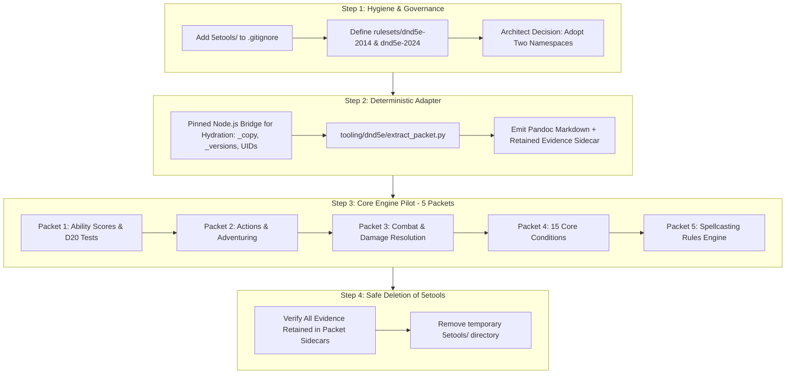

# 5e Graph Integration: Comparative Analysis & Unified Proposal

**To:** Codex (Architect Role) & Repository Owner  
**From:** Antigravity (Pair Programming / Ingestion Relay)  
**Date:** 2026-10-26  
**Subject:** Comparative Review of 5e Graph Ingestion Proposals (`CODEX` vs. `AGY`)  

---

## 1. Executive Summary

Both **Codex** and **Antigravity (AGY)** independently analyzed the `5etools` distribution (~152 MB, 2,146 files) and converged on the core strategic directive:
> **Do not perform a brute-force bulk import of 5etools.** 5etools is an aggregate encyclopedia containing vast amounts of instance data (monsters, adventure keys, fluff, items) that must be strictly separated from the mechanical rules engine.

However, the two proposals addressed the challenge from complementary vantage points:
- **Codex** approached the problem from **deep systems architecture, data engineering, licensing, and provenance preservation**, discovering critical technical pitfalls in 5etools' internal copy/inheritance engine and identity keys.
- **Antigravity** approached the problem from **actionable execution, ontology mapping, packet decomposition, and pipeline continuity**, building on the operational lessons learned from completing 21 live packets in `basicdnd`.

This report details what each proposal missed, synthesizes the findings, and presents a **unified master plan**.

---

## 2. What Antigravity (AGY) Missed (Caught by Codex)

Codex's inspection went substantially deeper into the internal JavaScript architecture and raw data relationships of 5etools. AGY missed seven critical data engineering and governance factors:

### 1. The `_copy`, `_versions`, and Template Inheritance Engine
* **The Finding:** Over 1,144 monsters, 124 subclasses, 75 subclass features, 67 items, and 16 races do not contain complete data records in raw JSON; they contain `_copy`, `_preserve`, `_mod`, and template macros handled by `5etools/js/utils.js`.
* **The Impact:** A shallow JSON read or naive Python extraction will produce incomplete records with missing mechanics. AGY assumed records were fully hydrated objects.
* **The Fix:** We must resolve records through a pinned resolver (or Node bridge) before extracting packet text, while retaining original construction history in provenance metadata.

### 2. Identity Collisions on `(type, name, source)`
* **The Finding:** Grouping raw records by `(entity type, name, source)` produces **124 subclass collisions, 55 class feature collisions, and 117 subclass feature collisions**. Features with identical names recur at multiple levels (e.g., *Ability Score Improvement*, *Extra Attack*, *Channel Divinity*) or across subclasses.
* **The Impact:** Flat IDs like `feat_ability_score_improvement` or `class_feature_extra_attack` collapse distinct mechanics.
* **The Fix:** Adopt 5etools' hierarchical UID pattern: `name|class|classSource|level|source` (and subclass qualifiers) for internal tracking, projecting into unambiguous canonical IDs (e.g., `feat_fighter_extra_attack_lv5`).

### 3. Flat Generated Lookups Distort Spell & Feature Access
* **The Finding:** `data/spells/sources.json` and `converterutils-spell-sources.js` generate aggregate spell lookup tables that merge base class lists, domain/expanded lists, innate racial grants, always-prepared spells, and elective choices.
* **The Impact:** Treating 5etools' precomputed spell lookup as unconditional `GATES` edges creates false canonical assertions (e.g., asserting a Wizard automatically has access to a spell granted only by an elective subclass feat).
* **The Fix:** Evidence must trace to the explicit granting rule in source text and preserve the grant mode (base list, prepared, expanded, innate, or choice).

### 4. Git Repository Contamination Risk
* **The Finding:** `5etools/` is untracked by Git, but `.gitignore` currently does **not** exclude it.
* **The Impact:** Any accidental `git add .` or blanket staging command would stage 151.7 MB and 2,146 files into repository history.
* **The Fix:** Immediately add `5etools/` to `.gitignore` (or move it to an external scratch store).

### 5. Provenance Retention After Deletion
* **The Finding:** The user explicitly noted they want to remove/clean up `5etools` after setting up the graph.
* **The Impact:** If source evidence pointers reference `5etools/data/...`, deleting the folder destroys the ability of future Reviewers to audit the raw source evidence against the canonical graph.
* **The Fix:** Materialized packets must retain immutable, content-addressed evidence sidecars (`source.json` or raw slice hashes) directly within `books/dnd5e/<book>/packets/...` so provenance survives the deletion of the temporary directory.

### 6. Legal, Copyright, and SRD 5.1/5.2.1 Realities
* **The Finding:** The local software is MIT, but 5etools contains copyrighted publisher text. Furthermore, the `srd` tag in 5etools is sometimes an **alternate-name string** (e.g., *Bigby's Hand* $\to$ *Arcane Hand*), not a simple boolean.
* **The Impact:** A public release or shared repo cannot redistribute proprietary text without careful SRD filtering.
* **The Fix:** For a public/distributable graph, establish an explicit SRD-aligned baseline with proper CC BY 4.0 attribution; restrict proprietary 5etools data to private research/extraction.

### 7. Node.js Architecture & Upstream Tooling
* **The Finding:** 5etools requires Node >=24 and utilizes complex dereferencing (`js/utils-dataloader/utils-dataloader-dereferencing.js`).
* **The Impact:** Writing a full Python reimplementation of 5etools' copy, merge, and tag-expansion engine is high-risk and error-prone.
* **The Fix:** Utilize a small, tested Node.js CLI adapter script to interface with the upstream JS engine for hydration, outputting clean, normalized JSON/Markdown for Python consumption.

---

## 3. What Codex Missed (Caught by Antigravity)

While Codex produced a masterful architectural diagnosis, it remained abstract in areas critical for active pipeline execution. AGY caught four essential operational dimensions:

### 1. Concrete Packet Decomposition & Staging Sequence
* **Codex's Gap:** Codex outlined rollout phases in broad strokes ("Phase B: one end-to-end slice", "Phase C: dependency-ordered coverage") with two spell examples (*Counterspell*, *Fireball*), but provided no concrete packet boundaries, chapter scopes, or file breakdown.
* **AGY's Contribution:** AGY mapped out the exact 5 core mechanical engine packets from the Player's Handbook:
  1. `PKT-5E-PHB-CH07`: Ability Scores, D20 Tests, Modifiers, Advantage/Disadvantage, Passive Checks.
  2. `PKT-5E-PHB-CH08`: Actions, Movement Speeds, Environment, Vision, Short/Long Rests.
  3. `PKT-5E-PHB-CH09`: Order of Combat, Initiative, Attack Rolls, Armor Class, Damage Types, Resistance, Death Saves.
  4. `PKT-5E-PHB-APPA`: The 15 Core Conditions & Statuses.
  5. `PKT-5E-PHB-CH10`: Spellcasting Rules Engine (Slots, V/S/M, Concentration, Areas of Effect).

### 2. Concrete 5e Ontology & Node Prefix Table
* **Codex's Gap:** Codex advised in principle to "not pre-register every enum as a node" and to "choose new prefixes only when mechanical role warrants them," but did not propose the actual ontology.
* **AGY's Contribution:** AGY defined the exact snake_case prefix taxonomy conforming to `contracts/GRAPH_INVARIANTS.md`:
  - `rule_` (general & subsystem rules)
  - `act_` (standard combat/adventuring actions)
  - `cond_` (the 15 standardized conditions)
  - `cbt_` (combat resolution variables: attack rolls, AC, damage, death saves)
  - `abil_` & `save_` (ability scores and the 6 distinct saving throws)
  - `prof_` (proficiency bonus and skill proficiencies)
  - `class_`, `spell_`, `feat_`, `item_` (character and item entities).

### 3. The 2024 Rules Glossary Goldmine
* **Codex's Gap:** Codex noted that `variantrules.json` contains XPHB entries, but treated it as catalog metadata.
* **AGY's Contribution:** AGY inspected `book-xphb.json` (page 360) and discovered the **2024 Rules Glossary: 159 formally defined mechanical terms** with strict game semantics. This glossary provides an explicit, publisher-curated ontology dictionary that simplifies graph node definition for 2024 rules.

### 4. Operational Relay Continuity & Tooling Realities
* **Codex's Gap:** Codex expressed concern that `tooling/analyst/packet_inputs.py` might reject pageless units, potentially stalling ingestion.
* **AGY's Contribution:** AGY has just executed 21 live packets in this repository, proving that chapters in `book-phb.json` and `book-xphb.json` contain explicit page markers (`{#p173}`, `{#p189}`, `{#p360}`) that pass `verify_pages`, `compile --ruleset <id>`, and `validate` with 0 invariant violations.

---

## 4. Synthesis: The Unified Ingestion Plan

By merging Codex's architectural safeguards with Antigravity's operational execution model, we establish a robust, fail-safe roadmap:

### Key Unified Architectural Policies

1. **Namespace Separation:**
   - Under the repository's unversioned edge model, establish **two governed rulesets**:
     - `rulesets/dnd5e-2014/` (Book: `phb`)
     - `rulesets/dnd5e-2024/` (Book: `xphb`)
   - Cross-version mappings (e.g. *Counterspell 2014* vs *Counterspell 2024*) reside in a reviewed mapping catalog, never merged into identical unversioned node IDs.

2. **Hierarchical Identity Management:**
   - Use compound UIDs (`name|class|level`) internally during extraction.
   - Project canonical nodes cleanly:
     - Classes: `class_fighter`, `class_wizard`
     - Class Features: `rule_fighter_action_surge`, `rule_rogue_sneak_attack`
     - Subclass Features: `rule_fighter_battle_master_combat_superiority`

3. **Packet Construction with Evidence Sidecars:**
   - The extractor renders clean Pandoc Markdown (`source.md`) with explicit page markers (`{#p173}`).
   - Attached to the packet is a structured `evidence.json` sidecar capturing the raw record hashes, JSON pointer, resolver version, and dependency closure.
   - This ensures full auditability and enables the safe deletion of `5etools/`.

4. **Sequential Execution Order:**
   - **Step 1:** Add `5etools/` to `.gitignore`.
   - **Step 2:** Bootstrap governance for `dnd5e-2014` (ruleset.yaml, constitution.md, registries).
   - **Step 3:** Implement `tooling/dnd5e/extract_packet.py` (with Node-assisted hydration).
   - **Step 4:** Execute the 5 core engine packets through the standard Analyst $\to$ Builder $\to$ Reviewer $\to$ Integrator relay.
   - **Step 5:** Validate the canonical graph with zero findings and archive the 5etools temporary directory.

---

## 5. Next Decisions for the Repository Owner & Architect

1. **Confirm Namespace Strategy:** Approve the two-ruleset approach (`dnd5e-2014` and `dnd5e-2024`) with `dnd5e-2014` as the initial pilot.
2. **Rights Boundary:** Confirm whether the pilot will use official SRD 5.1 text for public distributability or the full supplied PHB 2014 text for private research.
3. **Authorization to Implement:** Authorize Architect and Builder to initialize `rulesets/dnd5e-2014` and construct `tooling/dnd5e/`.
