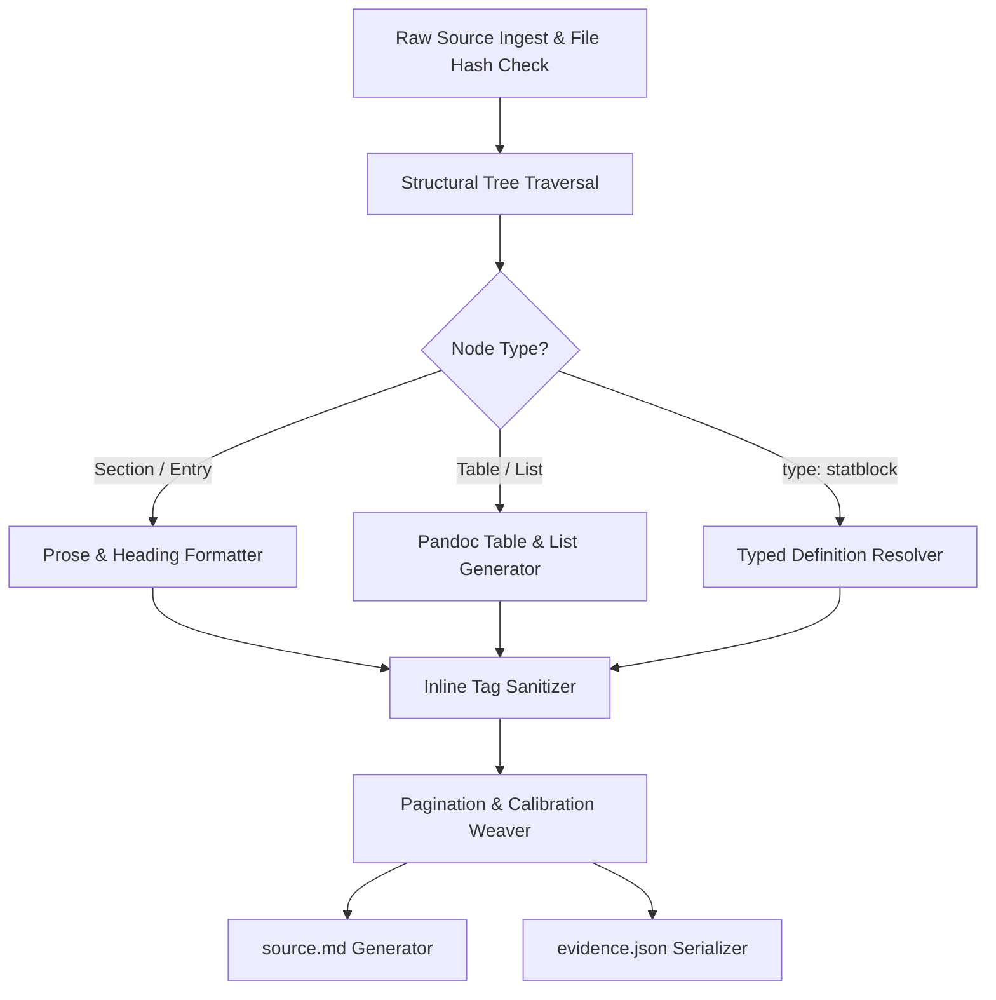
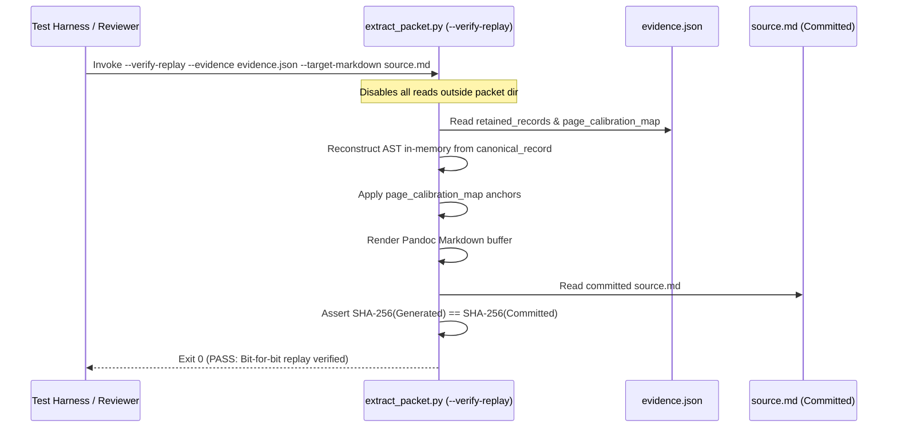

# Adapter Profile 1: Core Document Implementation Specification & Acceptance Suite

**Document Type:** Technical Implementation Specification & Verification Suite  
**Target Ruleset:** `dnd5e-2024` (2024 D&D 5th Edition Revised Core, `XPHB`)  
**Target Tool:** `tooling/dnd5e/extract_packet.py`  
**Test Suite:** `tooling/dnd5e/tests/test_profile_1_acceptance.py`  
**Schema Definition:** `tooling/dnd5e/schemas/evidence-manifest.schema.json`  
**Author:** Antigravity (Builder/Analyst candidate proposal)  
**Governing Authority:** Architect (Codex)  
**Status:** DRAFT SPECIFICATION (Pre-Implementation)  

> [!IMPORTANT]
> **Operational Boundary:** This document specifies the engineering design, CLI interfaces, AST translation rules, evidence serialization schemas, and acceptance tests for **Adapter Profile 1**.  
> Drafting this specification does **not** authorize production packet extraction, repository intake, or canonical graph mutation. Live extraction and canonical integration require separate role handoffs and approvals per `contracts/HERDR_HANDOFFS.md` and `contracts/PACKET_LIFECYCLE.md`.

---

## 1. Scope & Objective

Adapter Profile 1 (Core Document Profile) provides deterministic, verifiable extraction of core narrative rules, chapter prose, structured tables, and typed definition stubs from the 2024 *Player's Handbook* (`XPHB`).

### Supported Source Inputs
* **Primary Structural Hierarchy:** `5etools/data/book/book-xphb.json`
* **Typed Definition Collections (Rules Glossary):**
  1. `5etools/data/variantrules.json` (115 core & subsystem rules)
  2. `5etools/data/actions.json` (13 standardized actions)
  3. `5etools/data/conditionsdiseases.json` (15 conditions + 3 statuses: Bloodied, Concentration, Surprised)
  4. `5etools/data/senses.json` (4 special senses)
  5. `5etools/data/trapshazards.json` (5 environmental hazards)

### Generated Packet Outputs
Every extraction target in `books/dnd5e-2024/xphb/packets/incoming/PKT-.../` produces exactly two immutable companion files:
1. **`source.md`:** Valid Pandoc Markdown conforming to `contracts/SOURCE_MARKDOWN.md` with explicit, verified page markers (`{#pNNN}`).
2. **`evidence.json`:** Immutable audit sidecar containing raw file digests, versioned calibration coordinates, canonical RFC 8785 JCS records, and an all-inclusive provenance digest.

---

## 2. CLI Interface & Tooling Architecture

The extractor script is located at `tooling/dnd5e/extract_packet.py` and supports four deterministic modes of operation:

```
usage: python tooling/dnd5e/extract_packet.py <command> [options]

Commands:
  extract         Extracts a bounded source slice into source.md and evidence.json
  verify-replay   Regenerates source.md strictly from evidence.json and asserts byte identity
  verify-evidence Validates an existing evidence.json against schema and internal hashes
  audit-glossary  Audits the 155 Rules Glossary definitions across the 5 source files
```

### CLI Flag Specification (`extract`)
* `--packet <packet-id>`: Unique packet identifier (e.g. `PKT-5E-XPHB-360-378-rules-glossary`).
* `--source-root <path>`: Path to local upstream 5etools directory (default: `5etools/`).
* `--book-locus <json-pointer>`: Structural locus in `book-xphb.json` (e.g. `/bookData/0/data/10`).
* `--calibration-map <path>`: Path to input calibration JSON if multi-page manual calibration is active.
* `--output-dir <path>`: Destination directory under `books/dnd5e-2024/xphb/packets/incoming/<packet-id>/`.
* `--fail-on-uncalibrated`: Enforces fail-closed intake gate if multi-page sections lack page markers.

### CLI Flag Specification (`verify-replay`)
* `--evidence <path>`: Path to committed `evidence.json`.
* `--target-markdown <path>`: Path to committed `source.md`.
* `--isolated`: Explicitly disables all filesystem reads outside the target packet directory, verifying that `5etools/` is unneeded.

---

## 3. Structural AST Parser & Resolver Pipeline

The extraction pipeline consists of seven sequential stages:



### 3.1. Typed Embedded-Definition Resolver
When the traverser encounters an entry object where `type == "statblock"`, it dispatches a typed lookup using the tuple `(tag, name, source)`:

```python
RESOLVER_DISPATCH = {
    "variantrule": ("data/variantrules.json", "variantrule"),
    "action": ("data/actions.json", "action"),
    "condition": ("data/conditionsdiseases.json", "condition"),
    "status": ("data/conditionsdiseases.json", "condition"),
    "sense": ("data/senses.json", "sense"),
    "hazard": ("data/trapshazards.json", "hazard"),
}
```

**Resolution Rules:**
1. **Source Matching:** Record must match `source == "XPHB"`. Fallback to 2014 (`PHB`) or other sourcebooks is prohibited and triggers a fatal error.
2. **Name Normalization:** Exact string match on `name`.
3. **Fail-Closed Execution:** If a `statblock` entry does not resolve to exactly one upstream record, extraction immediately aborts with non-zero exit code reporting target coordinates and JSON pointer.
4. **Header Attribution:** Inlined definitions carry a level-3 header (`### <Name>`) and retain their own declared page citation.

### 3.2. Inline Tag Handling Boundaries
5etools embeds semantic tags in text strings (`{@tag target|source|display}`). Profile 1 enforces strict rendering boundaries:

* **Text/Prose Tags (Rendered inline):**
  - `{@dice 1d20}` $\to$ `1d20`
  - `{@damage 2d6}` $\to$ `2d6`
  - `{@dc 15}` $\to$ `DC 15`
  - `{@b text}` $\to$ `**text**`
  - `{@i text}` $\to$ `*text*`
* **Semantic Reference Tags (Rendered as text, NEVER inlined):**
  - `{@condition blinded}` $\to$ `Blinded`
  - `{@action Dash}` $\to$ `Dash`
  - `{@sense Darkvision}` $\to$ `Darkvision`
  - `{@spell Fireball|XPHB}` $\to$ `*Fireball*`
  *Rule:* Reference tags are never expanded into sub-definition blocks. They remain flat text or hyperlinks to prevent recursive packet bloat.
* **Unrecognized Tags:** Any tag not explicitly in the Profile 1 parser whitelist triggers a fatal parsing error, preventing silent string loss.

---

## 4. Pagination, Calibration & Coordinate Specification

`contracts/SOURCE_MARKDOWN.md:95` mandates:
> *"The most recent page assignment remains in effect until the next marker. The marker placement determines where that assignment begins."*

Because preceding page markers continuously govern subsequent text, multi-page sections without internal page breaks cannot be emitted with a single initial marker and "unanchored" later text.

### 4.1. The Multi-Page Intake Gate
During extraction:
1. **Single-Page Verification:** If an entry resides entirely on a verified page `N` (e.g. standard glossary definitions), the adapter emits `{#pN}`.
2. **Multi-Page Uncalibrated Sections:** If a chapter or section spans multiple physical pages (e.g. Chapter 1 text across pp. 7–31) and upstream data does not contain paragraph-level page break annotations, the adapter **halts extraction** unless a valid `--calibration-map` is supplied.

### 4.2. Calibration Coordinate Model
When manual calibration is performed against print/PDF copies, insertion loci are recorded in `page_calibration_map` within `evidence.json`.

**Anchor Coordinate Standard:**
* **Coordinate Target (`insertion_point`):**
  - `entry_start`: Insert marker immediately preceding the entry/section header.
  - `entry_end`: Insert marker immediately following the entry block.
  - `table_row`: Insert marker before row index `N` within a named table.
  - `text_offset`: Insert marker within an entry paragraph string at an exact character offset.
* **Character-Offset Standard:**
  - Offsets are **zero-indexed Unicode codepoints** measured strictly against the raw upstream JSON source string (`entries[i]`) prior to Markdown rendering.
  - Using upstream codepoints ensures that coordinate anchors remain invariant to Markdown formatting changes, spacing, or tag syntax adjustments.

```json
{
  "calibration_version": "1.0.0",
  "status": "calibrated",
  "anchors": [
    {
      "page": 8,
      "marker": "{#p8}",
      "target_json_pointer": "/bookData/0/data/1/entries/2",
      "insertion_point": "text_offset",
      "string_index": 1,
      "codepoint_offset": 342,
      "text_lead_in": "When the outcome of an action is uncertain",
      "verifier": "Analyst-Steward",
      "verified_date": "2026-10-27"
    }
  ]
}
```

---

## 5. Implementable Evidence Schema: `evidence-manifest.schema.json`

The schema governing `evidence.json` is stored at `tooling/dnd5e/schemas/evidence-manifest.schema.json`.

```json
{
  "$schema": "https://json-schema.org/draft/2020-12/schema",
  "$id": "repo:tooling/dnd5e/schemas/evidence-manifest.schema.json",
  "title": "5e Packet Evidence Manifest",
  "type": "object",
  "required": [
    "manifest_version",
    "packet_id",
    "environment",
    "raw_file_digests",
    "page_calibration_map",
    "retained_records",
    "provenance_content_digest"
  ],
  "properties": {
    "manifest_version": { "type": "string", "enum": ["1.0.0"] },
    "packet_id": { "type": "string", "pattern": "^PKT-5E-XPHB-[0-9]{3}-[0-9]{3}-[a-z0-9-]+$" },
    "environment": {
      "type": "object",
      "required": ["snapshot_identity", "tool_version", "parser_profile", "hash_algorithm", "canonicalization_method"],
      "properties": {
        "snapshot_identity": { "type": "string" },
        "tool_version": { "type": "string" },
        "parser_profile": { "type": "string", "enum": ["core-document-v1"] },
        "hash_algorithm": { "type": "string", "enum": ["SHA-256"] },
        "canonicalization_method": { "type": "string", "enum": ["RFC-8785-JCS"] }
      }
    },
    "raw_file_digests": {
      "type": "object",
      "additionalProperties": { "type": "string", "pattern": "^[a-f0-9]{64}$" }
    },
    "page_calibration_map": {
      "type": "object",
      "required": ["calibration_version", "status", "anchors"],
      "properties": {
        "calibration_version": { "type": "string" },
        "status": { "type": "string", "enum": ["uncalibrated", "calibrated", "single_page_verified"] },
        "anchors": {
          "type": "array",
          "items": {
            "type": "object",
            "required": ["page", "marker", "target_json_pointer", "insertion_point"],
            "properties": {
              "page": { "type": "integer", "minimum": 1 },
              "marker": { "type": "string", "pattern": "^{#p[0-9]+}$" },
              "target_entity": { "type": "string" },
              "target_json_pointer": { "type": "string" },
              "insertion_point": { "type": "string", "enum": ["entry_start", "entry_end", "text_offset", "table_row"] },
              "string_index": { "type": "integer" },
              "codepoint_offset": { "type": "integer" },
              "text_lead_in": { "type": "string" },
              "verifier": { "type": "string" },
              "verified_date": { "type": "string" }
            }
          }
        }
      }
    },
    "retained_records": {
      "type": "array",
      "items": {
        "type": "object",
        "required": ["entity_uid", "source_file", "json_pointer", "declared_page", "raw_record_sha256", "canonical_record"],
        "properties": {
          "entity_uid": { "type": "string" },
          "source_file": { "type": "string" },
          "json_pointer": { "type": "string" },
          "declared_page": { "type": "integer" },
          "raw_record_sha256": { "type": "string", "pattern": "^[a-f0-9]{64}$" },
          "canonical_record": { "type": "object" }
        }
      }
    },
    "provenance_content_digest": { "type": "string", "pattern": "^[a-f0-9]{64}$" }
  },
  "additionalProperties": false
}
```

### 5.1. Exact Hashing & Digest Computation Procedure
1. **Canonicalization Engine:** Retained structures are normalized using RFC 8785 JSON Canonicalization Scheme (JCS) (`sort_keys=True`, `separators=(',', ':')`, UTF-8 encoded without byte order mark).
2. **Canonical Manifest Payload:** The hash input consists of a JSON object containing the **closed set of six semantic fields**:
   `manifest_version`, `packet_id`, `environment`, `raw_file_digests`, `page_calibration_map`, `retained_records`.
3. **Excluded Fields:** `$schema`, `provenance_content_digest`, and any non-semantic execution fields are excluded from payload hashing.
4. **Digest Calculation:** `provenance_content_digest = SHA-256(JCS(canonical_manifest_payload))`.

---

## 6. Offline Replay Engine Specification

The offline replay engine guarantees that `source.md` can be reconstructed byte-for-byte indefinitely without the 151.7 MiB `5etools/` folder.



---

## 7. Acceptance Test Suite Specification

The test suite in `tooling/dnd5e/tests/test_profile_1_acceptance.py` contains eight automated test suites. All eight must pass cleanly under `pytest` before the Profile 1 adapter is authorized for active packet production:

### Test 1: Complete Rules Glossary Resolution
* **Fixture:** `test_glossary_resolution()`
* **Target:** Traverses `/bookData/0/data/10/entries/1/entries` in `book-xphb.json`.
* **Assertions:**
  - Exactly 155 definition references are detected.
  - All 155 resolve uniquely across the 5 source files under `source == "XPHB"`.
  - Type breakdown exactly matches: 115 variantrules, 15 conditions, 3 statuses, 13 actions, 5 hazards, 4 senses.
  - Zero collisions or unresolvable stubs.

### Test 2: Fail-Closed Reference & Error Trapping
* **Fixture:** `test_fail_closed_references()`
* **Scenarios:**
  - Inject a bogus tag: `{"type": "statblock", "tag": "invalid_kind", "name": "Test"}`.
  - Inject an ambiguous/missing name: `{"type": "statblock", "tag": "variantrule", "name": "NonExistent"}`.
  - Inject a 2014 sourcebook stub: `{"type": "statblock", "tag": "variantrule", "name": "Flanking", "source": "DMG"}`.
* **Assertions:**
  - Adapter terminates immediately with non-zero exit code.
  - Error output clearly identifies the target JSON pointer and failure reason.
  - No partial or corrupted `source.md` is emitted.

### Test 3: AST Tag Coverage & Unhandled Tag Rejection
* **Fixture:** `test_ast_tag_rejection()`
* **Scenarios:**
  - Provide an input entry containing an unhandled tag: `{@unknownTag payload}`.
* **Assertions:**
  - Adapter raises `UnhandledASTTagError`.
  - Proves that unknown formatting tags are never silently dropped or truncated.

### Test 4: Dual-Baseline Tamper & Upstream Drift Detection
* **Fixture:** `test_dual_baseline_fidelity()`
* **Sub-test 4A (Render Tamper):**
  - Mutate one word in a rendered `source.md` fixture.
  - Execute verification against committed `evidence.json`.
  - **Assertion:** Replay engine detects SHA-256 divergence and reports exact line/byte mismatch.
* **Sub-test 4B (Upstream Drift against Pinned Manifest):**
  - Mutate one entry string in an upstream source file.
  - Execute extractor against an independently pinned test manifest (`tooling/dnd5e/tests/fixtures/pinned_input_manifest.json`).
  - **Assertion:** Adapter detects raw file digest mismatch and halts before generating tainted evidence.

### Test 5: Pagination Attribution & Continuous Assignment Enforcement
* **Fixture:** `test_pagination_continuous_attribution()`
* **Scenarios:**
  - Attempt to extract a multi-page section without a calibration map.
  - Verify that no multi-page section is emitted with only a leading marker.
  - Verify that calibrated markers insert at the exact specified Unicode codepoints.
* **Assertions:**
  - Uncalibrated multi-page extraction halts under intake gate.
  - Calibrated rendering inserts `{#pNNN}` precisely at designated word boundaries.

### Test 6: Deterministic Serialization & Idempotence
* **Fixture:** `test_deterministic_idempotence()`
* **Execution:** Run the extractor three consecutive times on the same input packet.
* **Assertions:**
  - `source.md` is byte-for-byte identical across all runs.
  - `evidence.json` is byte-for-byte identical.
  - `provenance_content_digest` matches exactly across all runs.

### Test 7: Offline Replay Validation
* **Fixture:** `test_offline_replay()`
* **Execution:**
  - Isolate the packet directory in a temporary sandboxed environment where `5etools/` does not exist.
  - Execute `python tooling/dnd5e/extract_packet.py verify-replay --evidence evidence.json --target-markdown source.md`.
* **Assertions:**
  - Process exits 0 without network access or parent repository traversals.

### Test 8: Strict 2024 Edition Isolation
* **Fixture:** `test_edition_isolation()`
* **Scenarios:**
  - Scan all resolved AST nodes and evidence records.
* **Assertions:**
  - Zero references to 2014 source codes (`PHB`, `DMG`, `MM`).
  - All source fields strictly equal `"XPHB"`.

---

## 8. Role Boundaries & Execution Roadmap

Adhering to repository governance and role instructions:

| Stage | Responsible Role | Required Artifacts / Actions | Authority Gate |
| :--- | :--- | :--- | :--- |
| **Phase 1: Spec Review** | **Architect** | Review & formally approve this implementation spec. | Pre-implementation approval |
| **Phase 2: Adapter Build** | **Builder** | Implement `tooling/dnd5e/extract_packet.py`, schema, and tests. | Implementation sandbox |
| **Phase 3: Verification** | **Reviewer** | Run acceptance suite; verify offline replay on test packet. | Independent verification |
| **Phase 4: Calibration** | **Analyst / Steward** | Calibrate physical page markers for Topic Group 1. | Intake gate release |
| **Phase 5: First Relay** | **Analyst $\to$ Builder** | Begin packet relay on verified Topic Group 1 markdown. | Normal relay protocol |
| **Phase 6: Integration** | **Integrator** | Sole authority to mutate `rulesets/dnd5e-2024/canonical/`. | Integrated commit |

### Explicit Commitments
* No production extraction script will be run against canonical targets until this specification receives Architect approval.
* No files will be modified in `rulesets/` or `canonical/` during adapter development.
